<!-- Generated by scripts/build-readme.mjs. Edit the script, then run: node scripts/build-readme.mjs -->

<a href="https://tuzkituan.dev"><picture><source media="(prefers-color-scheme: dark)" srcset="assets/readme/hero-dark.55a0f702.svg"></picture></a>

<a href="https://tuzkituan.dev/#projects"><picture><source media="(prefers-color-scheme: dark)" srcset="assets/readme/projects-dark.fa37e2f4.svg">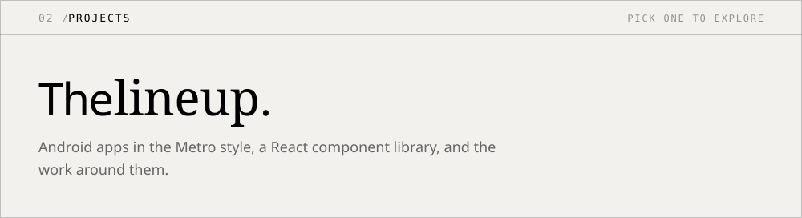</picture></a>

<a href="https://tuzkituan.dev/launcher"><picture><source media="(prefers-color-scheme: dark)" srcset="assets/readme/card-launcher-dark.0b6ce07d.svg">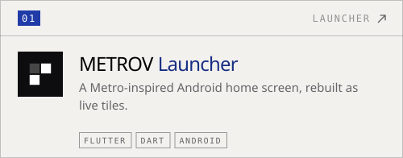</picture></a>
<a href="https://tuzkituan.dev/dial"><picture><source media="(prefers-color-scheme: dark)" srcset="assets/readme/card-dial-dark.7628bf32.svg">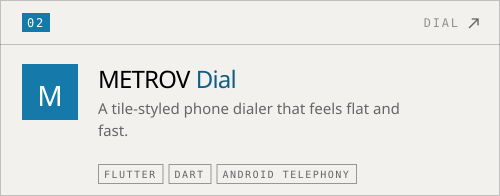</picture></a>

<a href="https://tuzkituan.dev/navbar"><picture><source media="(prefers-color-scheme: dark)" srcset="assets/readme/card-navbar-dark.1be87fcd.svg">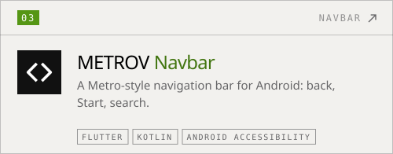</picture></a>
<a href="https://tuzkituan.dev/fimie"><picture><source media="(prefers-color-scheme: dark)" srcset="assets/readme/card-fimie-dark.f01dad67.svg">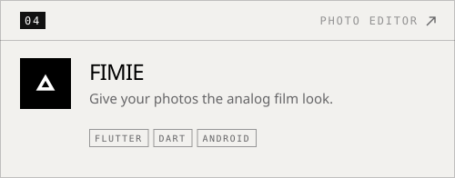</picture></a>

<a href="https://tuzkituan.dev/nightcap"><picture><source media="(prefers-color-scheme: dark)" srcset="assets/readme/card-nightcap-dark.a523ead0.svg">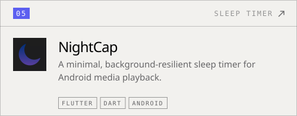</picture></a>
<a href="https://github.com/tuzkituan/zeni-ui"><picture><source media="(prefers-color-scheme: dark)" srcset="assets/readme/card-zeni-ui-dark.53254dcf.svg">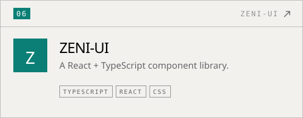</picture></a>

<a href="https://tuzkituan.dev/#press"><picture><source media="(prefers-color-scheme: dark)" srcset="assets/readme/press-dark.a67aa3ad.svg">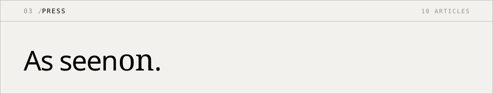</picture></a>

- **How-To Geek** · [This launcher turned my Pixel into a Nokia Lumia Windows Phone](https://www.howtogeek.com/this-launcher-turned-my-pixel-into-a-nokia-lumia-windows-phone/)
- **How-To Geek** · [This Android launcher turned my phone into the Windows 8 foldable Microsoft never made](https://www.howtogeek.com/this-android-launcher-turned-my-phone-into-the-windows-8-foldable-microsoft-never-made/)
- **Windows Central** · [METROV could be a hit if you loved the look of Windows Phone 8.1](https://www.windowscentral.com/hardware/windows-phone/metrov-windows-phone-launcher)
- **MakeUseOf** · [I've used vanilla Android for a decade and I regret not installing this launcher sooner](https://www.makeuseof.com/vanilla-android-decade-i-regret-not-installing-launcher/)
- **Yahoo Tech** · [The closest I've felt to using a Lumia again](https://tech.yahoo.com/apps/articles/closest-ive-felt-using-lumia-131307539.html)
- **MakeUseOf** · [These Android apps make my phone feel like a Windows Phone and I am obsessed](https://www.makeuseof.com/android-apps-make-phone-feel-like-windows-phone-am-obsessed/)
- **XDA Developers** · [These 4 Android launchers prove Windows Phone's design never really died](https://www.xda-developers.com/these-android-launchers-recreate-windows-phone-design/)
- **Pocket-lint** · [5 apps I use to transform my Android into a Windows Phone in 2026](https://www.pocket-lint.com/best-windows-style-launcher-apps-for-android/)
- **Xataka Móvil** · [Me cansé de cómo se ve mi móvil Android. Lo he solucionado viajando doce años atrás](https://www.xatakamovil.com/sistemas-operativos/escritorios-movil-se-han-vuelto-aburridos-he-tenido-que-viajar-doce-anos-atras-para-recuperar-pantalla-inicio-util)
- **Quantrimang** · [Tại sao nên cài đặt launcher METROV trên Vanilla Android?](https://quantrimang.com/cong-nghe/cai-dat-launcher-metrov-tren-vanilla-android-211955)

<a href="https://tuzkituan.dev/#contact"><picture><source media="(prefers-color-scheme: dark)" srcset="assets/readme/contact-dark.0359a47e.svg"></picture></a>

<a href="https://github.com/tuzkituan"><picture><source media="(prefers-color-scheme: dark)" srcset="assets/readme/contact-1-dark.f22fccb3.svg">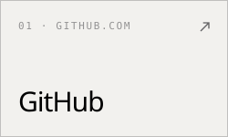</picture></a>
<a href="https://www.linkedin.com/in/ngoctuanitpy/"><picture><source media="(prefers-color-scheme: dark)" srcset="assets/readme/contact-2-dark.ad9ae5b1.svg"></picture></a>
<a href="mailto:tuannguyenitpy@gmail.com"><picture><source media="(prefers-color-scheme: dark)" srcset="assets/readme/contact-3-dark.9356ffa1.svg">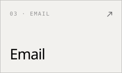</picture></a>
<a href="https://play.google.com/store/apps/developer?id=tuzkituan"><picture><source media="(prefers-color-scheme: dark)" srcset="assets/readme/contact-4-dark.6bc5a347.svg">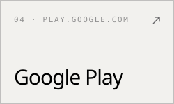</picture></a>

<a href="https://www.paypal.me/lewisnguyen2804"><picture><source media="(prefers-color-scheme: dark)" srcset="assets/readme/coffee-dark.ccefee7e.svg">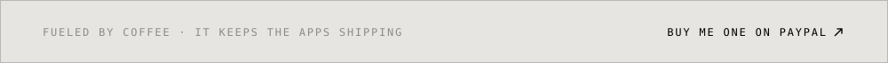</picture></a>
