[//]: 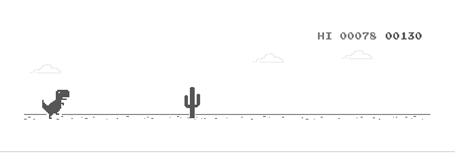

```console
tuzkituan@github:~$ neofetch

           tuzkituan@github
           ----------------
 /\_/\     OS     : Fedora Linux 44 (Workstation)
( o.o )    DE     : GNOME on Wayland
 > ^ <     Shell  : zsh
           Role   : frontend / mobile developer
           Stack  : ts · reactjs · flutter · linux
           Apps   : 5 shipped · 50K+ installs
           Web    : tuzkituan.dev
           Height : 171cm · Color: mint
```

<br />

###

```console
tuzkituan@github:~$ ls ~/apps
```

<table>
  <tr>
    <td width="1000"><b>METROV Launcher</b><br /><sub>A Metro-inspired Android home screen, rebuilt as live tiles.</sub></td>
    <td><a href="https://play.google.com/store/apps/details?id=com.tuzkituan.metrov">Google Play</a>&nbsp;·&nbsp;<a href="https://tuzkituan.dev/launcher">site</a></td>
  </tr>
  <tr>
    <td width="1000"><b>METROV Dial</b><br /><sub>A tile-styled phone dialer that feels flat and fast.</sub></td>
    <td><a href="https://urlshortener.at/MhRSP">Google Play</a>&nbsp;·&nbsp;<a href="https://tuzkituan.dev/dial">site</a></td>
  </tr>
  <tr>
    <td width="1000">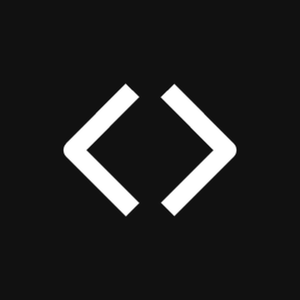<b>METROV Navbar</b><br /><sub>A Metro-style navigation bar for Android: back, Start, search.</sub></td>
    <td><a href="https://urlshortener.at/VJwPy">Google Play</a>&nbsp;·&nbsp;<a href="https://tuzkituan.dev/navbar">site</a></td>
  </tr>
  <tr>
    <td width="1000">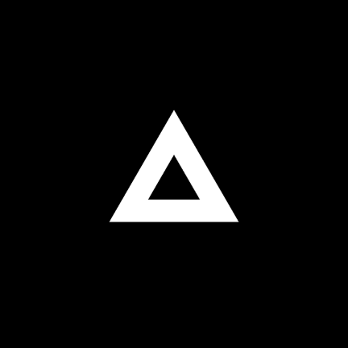<b>FIMIE</b><br /><sub>A film photo editor: give your photos the analog film look.</sub></td>
    <td><a href="https://urlshortener.at/9IH3f">APK</a>&nbsp;·&nbsp;<a href="https://tuzkituan.dev/fimie">site</a></td>
  </tr>
  <tr>
    <td width="1000">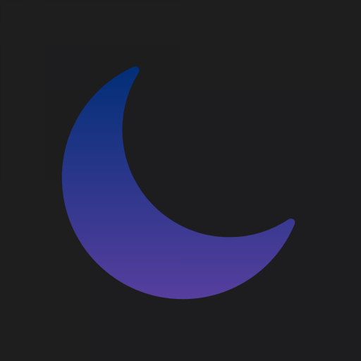<b>NightCap</b><br /><sub>A minimal sleep timer that pauses any media app. Open source.</sub></td>
    <td><a href="https://urlshortener.at/kpL40">APK</a>&nbsp;·&nbsp;<a href="https://github.com/tuzkituan/nightcap">GitHub</a>&nbsp;·&nbsp;<a href="https://tuzkituan.dev/nightcap">site</a></td>
  </tr>
</table>

<br />

###

```console
tuzkituan@github:~$ ./metrov --install   # Windows Phone-style launcher for Android
```

<div style="display: flex; flex-direction: row; flex-wrap: wrap; gap: 24px;">
<a href="assets/Screenshot_20260506-154731.png">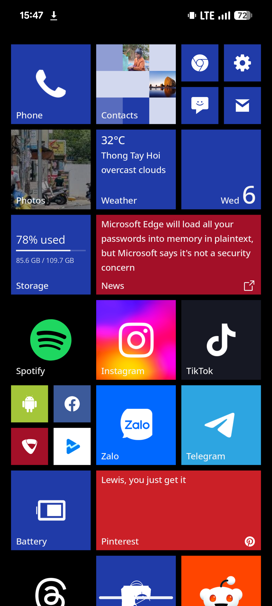</a>
<a href="assets/Screenshot_20260506-155037.png">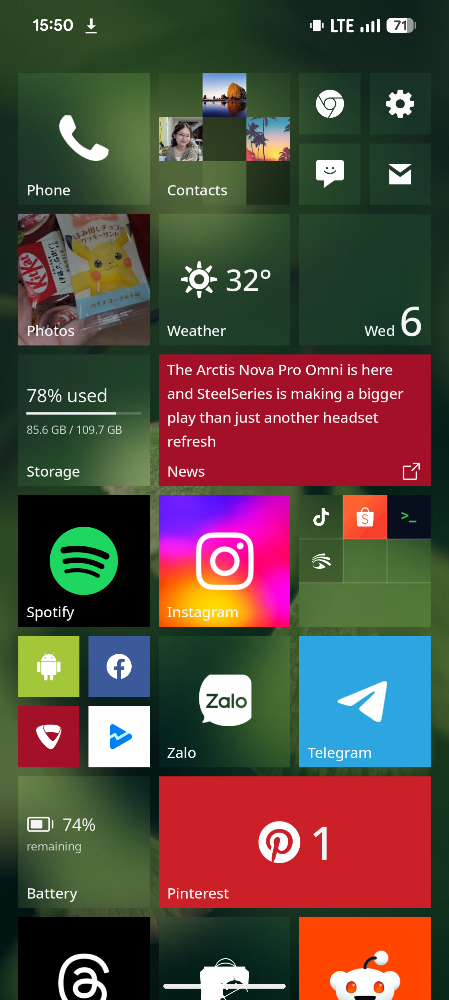</a>
<a href="assets/Screenshot_20260506-154158.png">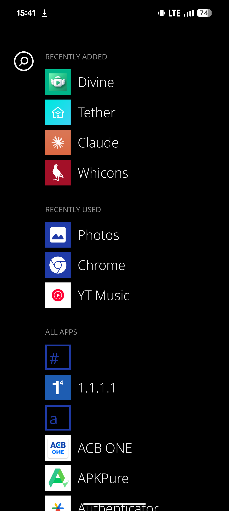</a>
<a href="assets/Screenshot_20260506-154907.png">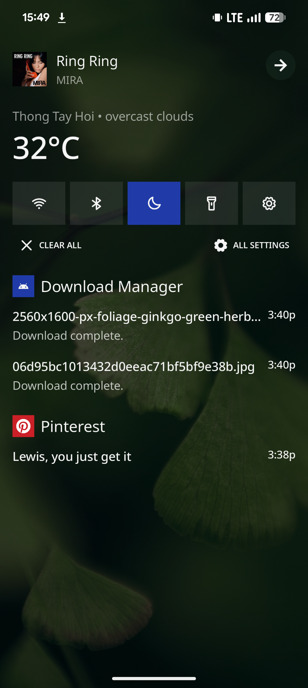</a>
<a href="assets/Screenshot_20260506-154204.png">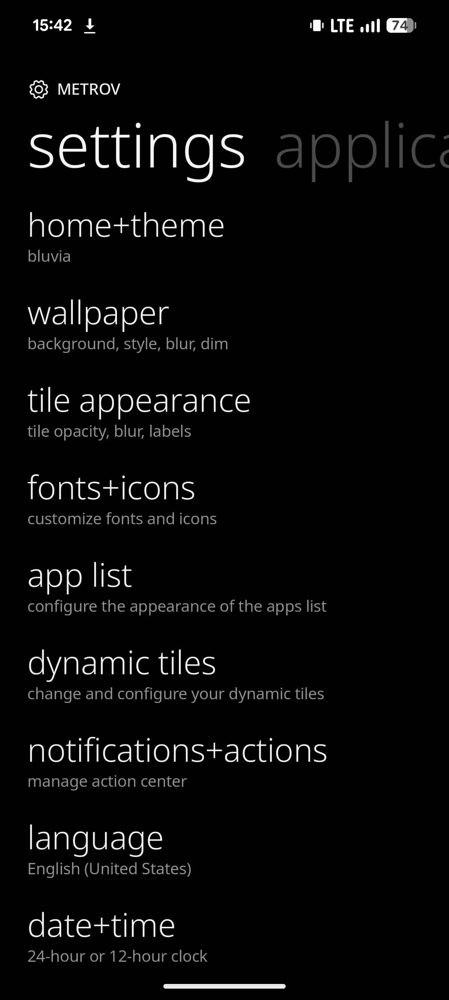</a>
</div>
<br />

[MakeUseOf](https://www.makeuseof.com/vanilla-android-decade-i-regret-not-installing-launcher/) &nbsp;·&nbsp;
[Windows Central](https://www.windowscentral.com/hardware/windows-phone/metrov-windows-phone-launcher) &nbsp;·&nbsp;
[Quantrimang](https://quantrimang.com/cong-nghe/cai-dat-launcher-metrov-tren-vanilla-android-211955) &nbsp;·&nbsp;
[Yahoo Tech](https://tech.yahoo.com/apps/articles/closest-ive-felt-using-lumia-131307539.html) &nbsp;·&nbsp;
[Pocket-lint](https://www.pocket-lint.com/best-windows-style-launcher-apps-for-android/) &nbsp;·&nbsp;
[HowToGeek](https://www.howtogeek.com/this-launcher-turned-my-pixel-into-a-nokia-lumia-windows-phone/)

<br />

###

```console
tuzkituan@github:~$ ls ~/apps --new --preview   # dial · navbar · fimie · nightcap
```

<p>
<a href="https://tuzkituan.dev/dial">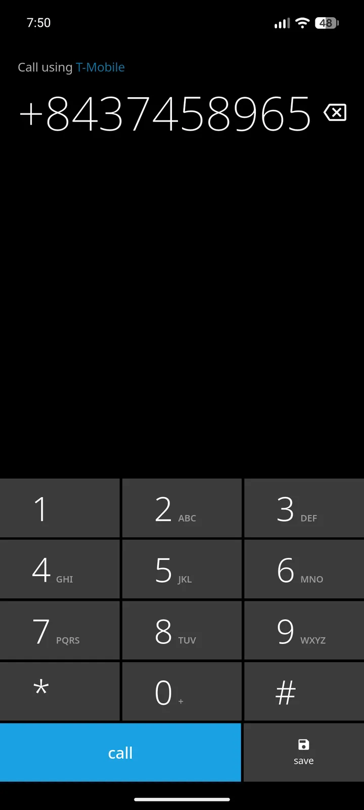</a>
<a href="https://tuzkituan.dev/navbar">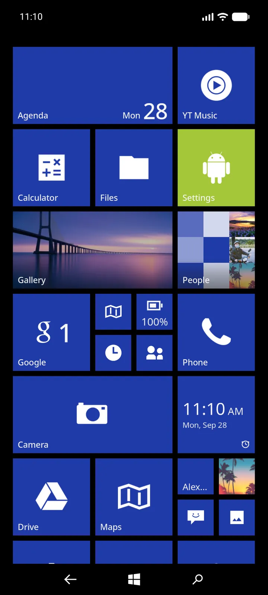</a>
<a href="https://tuzkituan.dev/fimie">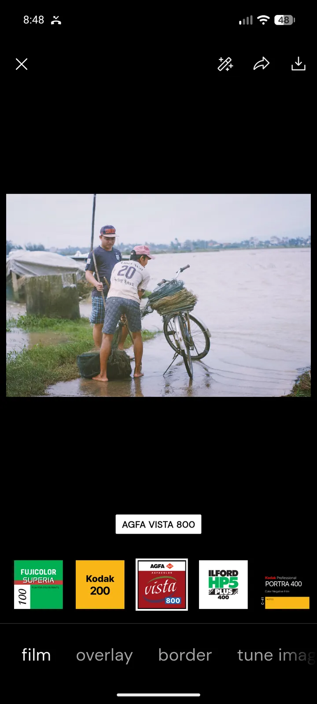</a>
<a href="https://tuzkituan.dev/nightcap">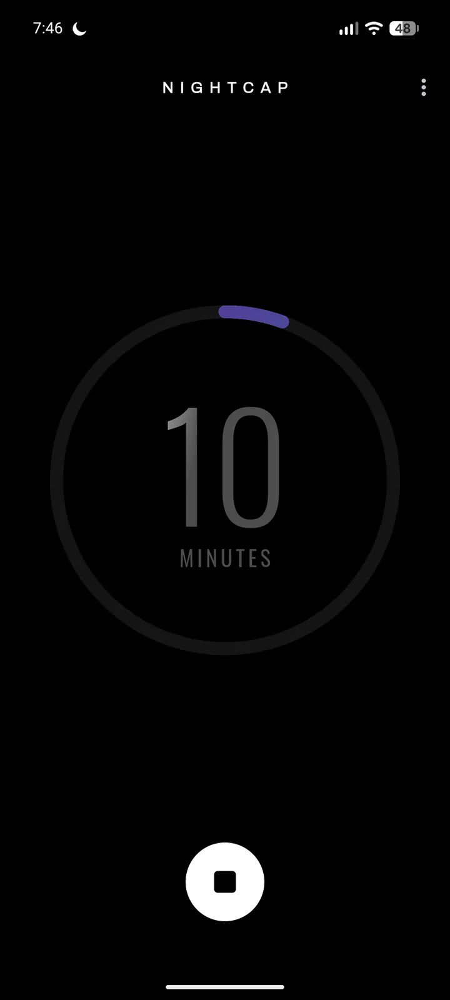</a>
</p>

<br />

###

```console
tuzkituan@github:~$ whois tuzkituan
```

<p>
<a href="mailto:tuannguyenitpy@gmail.com" target="_blank">
  
</a>
<a href="https://www.linkedin.com/in/ngoctuanitpy/" target="_blank">
  
</a>
<a href="https://tuzkituan.dev" target="_blank">
  
</a>
</p>

<br />

###

```console
tuzkituan@github:~$ sudo dnf install coffee
```

<p>
<a href="https://www.paypal.me/lewisnguyen2804" target="_blank">
  
</a>
</p>

<sub>thanks for the tip, it keeps the apps shipping ☕</sub>
