<!-- Generated by scripts/build-readme.mjs. Edit the script, then run: node scripts/build-readme.mjs -->

<a href="https://tuzkituan.dev"><picture><source media="(prefers-color-scheme: dark)" srcset="assets/readme/hero-dark.236cd097.svg"></picture></a>

<a href="https://tuzkituan.dev/#projects"><picture><source media="(prefers-color-scheme: dark)" srcset="assets/readme/projects-dark.8e91d507.svg"></picture></a>

<a href="https://tuzkituan.dev/launcher"><picture><source media="(min-width: 1280px) and (prefers-color-scheme: dark)" srcset="assets/readme/card-launcher-wide-dark.a9c40d98.svg"><source media="(min-width: 1280px)" srcset="assets/readme/card-launcher-wide-light.6fe1ca4c.svg"><source media="(prefers-color-scheme: dark)" srcset="assets/readme/card-launcher-narrow-dark.3ddc5d37.svg"></picture></a><a href="https://tuzkituan.dev/dial"><picture><source media="(min-width: 1280px) and (prefers-color-scheme: dark)" srcset="assets/readme/card-dial-wide-dark.b5b27bc6.svg"><source media="(min-width: 1280px)" srcset="assets/readme/card-dial-wide-light.b42d0443.svg"><source media="(prefers-color-scheme: dark)" srcset="assets/readme/card-dial-narrow-dark.3bcfec01.svg"></picture></a><a href="https://tuzkituan.dev/navbar"><picture><source media="(min-width: 1280px) and (prefers-color-scheme: dark)" srcset="assets/readme/card-navbar-wide-dark.e72d558f.svg"><source media="(min-width: 1280px)" srcset="assets/readme/card-navbar-wide-light.9fdec746.svg"><source media="(prefers-color-scheme: dark)" srcset="assets/readme/card-navbar-narrow-dark.a7b79dd8.svg"></picture></a><a href="https://tuzkituan.dev/fimie"><picture><source media="(min-width: 1280px) and (prefers-color-scheme: dark)" srcset="assets/readme/card-fimie-wide-dark.d4b8181e.svg"><source media="(min-width: 1280px)" srcset="assets/readme/card-fimie-wide-light.ea0b2ed5.svg"><source media="(prefers-color-scheme: dark)" srcset="assets/readme/card-fimie-narrow-dark.3900503c.svg"></picture></a><a href="https://tuzkituan.dev/nightcap"><picture><source media="(min-width: 1280px) and (prefers-color-scheme: dark)" srcset="assets/readme/card-nightcap-wide-dark.936f9ed5.svg"><source media="(min-width: 1280px)" srcset="assets/readme/card-nightcap-wide-light.5b65eb75.svg"><source media="(prefers-color-scheme: dark)" srcset="assets/readme/card-nightcap-narrow-dark.c314c36f.svg"></picture></a><a href="https://github.com/tuzkituan/zeni-ui"><picture><source media="(min-width: 1280px) and (prefers-color-scheme: dark)" srcset="assets/readme/card-zeni-ui-wide-dark.440bdb33.svg"><source media="(min-width: 1280px)" srcset="assets/readme/card-zeni-ui-wide-light.c203d3a3.svg"><source media="(prefers-color-scheme: dark)" srcset="assets/readme/card-zeni-ui-narrow-dark.64d13d30.svg"></picture></a>

<a href="https://tuzkituan.dev/#press"><picture><source media="(prefers-color-scheme: dark)" srcset="assets/readme/press-dark.fc572788.svg"></picture></a>

- **How-To Geek** · [This launcher turned my Pixel into a Nokia Lumia Windows Phone](https://www.howtogeek.com/this-launcher-turned-my-pixel-into-a-nokia-lumia-windows-phone/)
- **How-To Geek** · [This Android launcher turned my phone into the Windows 8 foldable Microsoft never made](https://www.howtogeek.com/this-android-launcher-turned-my-phone-into-the-windows-8-foldable-microsoft-never-made/)
- **Windows Central** · [METROV could be a hit if you loved the look of Windows Phone 8.1](https://www.windowscentral.com/hardware/windows-phone/metrov-windows-phone-launcher)
- **MakeUseOf** · [I've used vanilla Android for a decade and I regret not installing this launcher sooner](https://www.makeuseof.com/vanilla-android-decade-i-regret-not-installing-launcher/)
- **Yahoo Tech** · [The closest I've felt to using a Lumia again](https://tech.yahoo.com/apps/articles/closest-ive-felt-using-lumia-131307539.html)
- **MakeUseOf** · [These Android apps make my phone feel like a Windows Phone and I am obsessed](https://www.makeuseof.com/android-apps-make-phone-feel-like-windows-phone-am-obsessed/)
- **XDA Developers** · [These 4 Android launchers prove Windows Phone's design never really died](https://www.xda-developers.com/these-android-launchers-recreate-windows-phone-design/)
- **Pocket-lint** · [5 apps I use to transform my Android into a Windows Phone in 2026](https://www.pocket-lint.com/best-windows-style-launcher-apps-for-android/)
- **Xataka Móvil** · [Me cansé de cómo se ve mi móvil Android. Lo he solucionado viajando doce años atrás](https://www.xatakamovil.com/sistemas-operativos/escritorios-movil-se-han-vuelto-aburridos-he-tenido-que-viajar-doce-anos-atras-para-recuperar-pantalla-inicio-util)
- **Quantrimang** · [Tại sao nên cài đặt launcher METROV trên Vanilla Android?](https://quantrimang.com/cong-nghe/cai-dat-launcher-metrov-tren-vanilla-android-211955)

<a href="https://tuzkituan.dev/#contact"><picture><source media="(prefers-color-scheme: dark)" srcset="assets/readme/contact-dark.518e1274.svg"></picture></a>

<a href="https://github.com/tuzkituan"><picture><source media="(min-width: 1280px) and (prefers-color-scheme: dark)" srcset="assets/readme/contact-1-wide-dark.80135305.svg"><source media="(min-width: 1280px)" srcset="assets/readme/contact-1-wide-light.81f89134.svg"><source media="(prefers-color-scheme: dark)" srcset="assets/readme/contact-1-narrow-dark.6ad5e9fb.svg"></picture></a><a href="https://www.linkedin.com/in/ngoctuanitpy/"><picture><source media="(min-width: 1280px) and (prefers-color-scheme: dark)" srcset="assets/readme/contact-2-wide-dark.33a74be6.svg"><source media="(min-width: 1280px)" srcset="assets/readme/contact-2-wide-light.8cc56a29.svg"><source media="(prefers-color-scheme: dark)" srcset="assets/readme/contact-2-narrow-dark.412442b6.svg"></picture></a><a href="mailto:tuannguyenitpy@gmail.com"><picture><source media="(min-width: 1280px) and (prefers-color-scheme: dark)" srcset="assets/readme/contact-3-wide-dark.64d87aa0.svg"><source media="(min-width: 1280px)" srcset="assets/readme/contact-3-wide-light.91a98e68.svg"><source media="(prefers-color-scheme: dark)" srcset="assets/readme/contact-3-narrow-dark.f9627240.svg"></picture></a><a href="https://play.google.com/store/apps/developer?id=tuzkituan"><picture><source media="(min-width: 1280px) and (prefers-color-scheme: dark)" srcset="assets/readme/contact-4-wide-dark.6f8b73d5.svg"><source media="(min-width: 1280px)" srcset="assets/readme/contact-4-wide-light.8369c39d.svg"><source media="(prefers-color-scheme: dark)" srcset="assets/readme/contact-4-narrow-dark.5c73e014.svg"></picture></a>

<a href="https://www.paypal.me/lewisnguyen2804"><picture><source media="(prefers-color-scheme: dark)" srcset="assets/readme/coffee-dark.f8d11e09.svg"></picture></a>
